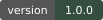
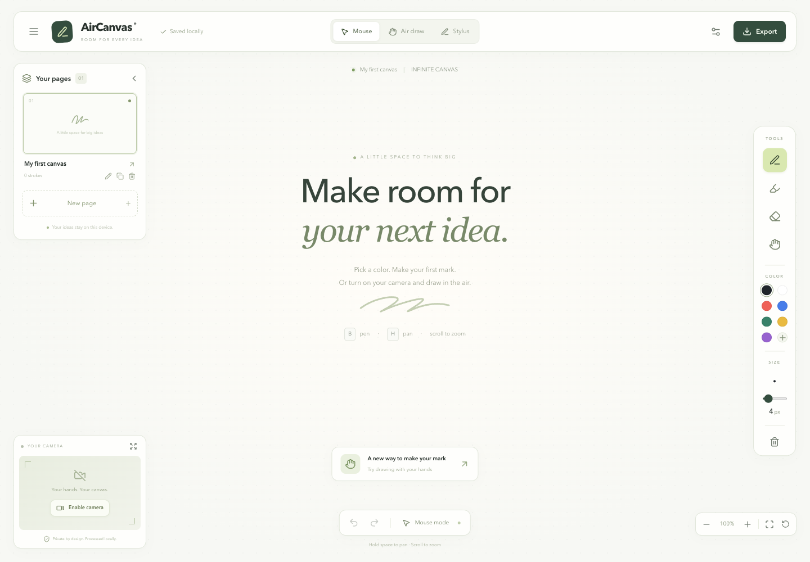
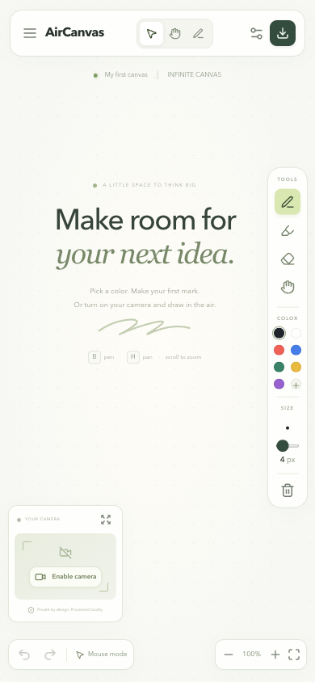

# Offhand

[](aircanvas/frontend/package.json)
[](#quick-start)

A local, webcam-controlled infinite whiteboard. Draw with a mouse, your index finger, or a pen with a colored marker. Your handwriting stays as editable vector strokes; there is no OCR or cloud vision service.

## Features

- **Infinite canvas:** pan, zoom, and draw with smooth, editable strokes.
- **Three input modes:** mouse, webcam finger tracking, and an optional colored-marker stylus.
- **Gesture navigation:** pinch to write; open your other palm, then close it into a fist to pan.
- **Independent pages:** thumbnails, page management, per-page history, and saved viewport positions.
- **Local persistence:** IndexedDB autosave and portable JSON project files.
- **PNG exports:** white or camera backgrounds, with multiple resolution options.
- **Private processing:** hand tracking runs in your browser; optional marker tracking stays on localhost.

## Contents

- [Screenshots](#screenshots)
- [Quick start](#quick-start)
- [Using the canvas](#using-the-canvas)
- [Air drawing](#air-drawing)
- [Optional pen/stylus mode](#optional-penstylus-mode)
- [Saving and exporting](#saving-and-exporting)
- [Architecture](#architecture)
- [Development and testing](#development-and-testing)
- [Troubleshooting](#troubleshooting)
- [Deployment](#deployment)

## Screenshots

These screenshots show the current **AirCanvas** editor included in Offhand, running in Mouse mode.

### Desktop workspace

The infinite canvas with its page sidebar, drawing dock, camera controls, and zoom tools.



### Mobile workspace

The responsive layout keeps drawing tools and canvas navigation within reach on a smaller screen.



## Quick start

### Requirements

- **Node.js 22.12 or newer** and npm.
- A recent browser with WebAssembly, Canvas, and IndexedDB support.
- A webcam for air drawing, with the app served from **localhost or HTTPS**.
- **Python 3.11+** only for the optional colored-marker backend.

### Install and run

1. Clone the repository and install the frontend dependencies:

   ```sh
   git clone https://github.com/sayushmaharjan/Offhand.git
   cd Offhand/aircanvas/frontend
   npm ci
   ```

2. Start the development server:

   ```sh
   npm run dev
   ```

3. Open **[http://127.0.0.1:5173](http://127.0.0.1:5173)** and begin in **Mouse** mode. The editor works even when a camera is unavailable or the tracking model fails.

Installation downloads the official MediaPipe hand model once and copies the matching WebAssembly runtime into `public/`. Internet access is needed for dependency/model installation; runtime vision processing uses locally served assets. To retry an interrupted model download, run:

```sh
npm run assets
```

### Alternative launcher

If Python is available, you can also start the frontend from the repository root:

```sh
python3 main.py
```

The launcher uses Node.js from your PATH or a project-local runtime if one is present. It installs missing npm dependencies and starts the frontend. Finger mode does not require a running Python service.

## Using the canvas

### Drawing and navigation

- **Mouse:** drag to draw; choose pen, highlighter, eraser, or hand in the right dock. The eraser removes entire strokes. Brush widths are 1–30 world units.
- **Pan:** select Hand, hold Space and drag, use the middle/right mouse button, or Shift + scroll. Two-finger touch gestures pan and zoom.
- **Zoom:** scroll, use a trackpad pinch, press `+`/`−`, or use the bottom-right controls. Fit centers all content; Reset returns to 100% at the origin.
- **Pages:** use the hamburger button. Add, rename, duplicate, delete, or switch pages. Every page has independent ink, view, and undo/redo stacks. Deletion asks for confirmation.
- **History:** retain up to 80 edits per page during a session. Clear is undoable.

### Keyboard shortcuts

| Shortcut                                    | Action                         |
| ------------------------------------------- | ------------------------------ |
| `B`                                         | Select the pen                 |
| `E`                                         | Select the eraser              |
| `H`                                         | Select the hand tool           |
| `Space` + drag                              | Pan the canvas                 |
| `+` / `−`                                   | Zoom in / out                  |
| `Ctrl/Cmd` + `Z`                            | Undo                           |
| `Ctrl/Cmd` + `Shift` + `Z`, or `Ctrl` + `Y` | Redo                           |
| `Ctrl/Cmd` + `S`                            | Open PNG export                |
| `D`                                         | Toggle pen-down in Stylus mode |

## Air drawing

### Calibrate and draw

Select **Air draw**, enable the camera, and follow the eight-step hand check. Setup observes real detections before marking a step complete. You can skip setup and revisit it in Settings.

1. Move your **right index fingertip** to hover. Pinch the thumb and index finger to draw; release to end the stroke.
2. Show your **left open palm** to arm navigation. Close it into a fist to grab, then move the fist to pan. Open it to release.
3. Panning takes priority over writing. Release and re-pinch after a grab or menu interaction to resume writing.

### Adjust the controls

Settings let you:

- Swap writing and navigation hands for left-handed use.
- Choose the alternate extended-index drawing gesture.
- Adjust confidence, smoothing, pinch threshold, pointer sensitivity, and grab sensitivity.
- Keep pointer sensitivity at **1** for exact fingertip-to-camera alignment.
- Use **Invert model hand labels** if calibration identifies your physical hands incorrectly.

The mirrored camera background uses `object-fit: cover`; tracking and exports use the same crop and aspect-ratio calculation. You can keep a small camera preview or enable a full camera overlay and adjust its whiteboard opacity. Tracking feedback is optional and never exported.

### Tracking interruptions

A new pinch requires two stable detections; release and tracking loss stop ink immediately. Sudden position jumps, stale detections, hidden tabs, modal dialogs, and pointers over controls also interrupt writing. A new stroke is used after a tracking gap.

## Optional pen/stylus mode

### Start the local tracker

Use **Python 3.11+**. From the repository root on macOS or Linux:

```sh
python3.11 -m venv .venv
source .venv/bin/activate
pip install -r aircanvas/backend/requirements.txt
python -m uvicorn aircanvas.backend.main:app --host 127.0.0.1 --port 8000
```

For subsequent runs, reuse the prepared virtual environment:

```sh
.venv/bin/python -m uvicorn aircanvas.backend.main:app --host 127.0.0.1 --port 8000
```

`aircanvas/backend/requirements.lock.txt` records the exact Python package versions used for validation; install it instead of `requirements.txt` to reproduce that environment.

### Calibrate a marker

1. Keep the frontend running in another terminal.
2. Place a small, bright, saturated colored marker close to the pen tip.
3. Choose **Stylus** and open **Settings**.
4. Click the marker in the mirrored calibration preview to sample its color.
5. Adjust HSV tolerance if needed and remove similarly colored objects from the background.

Tracking provides the marker's centroid, not an exact unmarked pen-tip location. Place the marker as close to the tip as practical.

### Pen-down controls

Drawing activation is explicit:

| Navigation hand / keyboard  | Result                                          |
| --------------------------- | ----------------------------------------------- |
| Pinch held                  | Draw while the marker is reliably detected      |
| Open palm                   | Pen up; also clears the keyboard drawing toggle |
| Open palm, then fist        | Grab and pan; drawing is suppressed             |
| `D`                         | Toggle drawing as a keyboard fallback           |
| Missing or ambiguous marker | End the current stroke                          |

Frames travel only to `127.0.0.1:8000`, with one marker request in flight. The service rejects browser origins other than the local dev/preview frontend, keeps frames in memory only, and binds to loopback by default. Finger mode never contacts it. Generic object detection is not used. `PenTipTracker` and `PenTipDetector` provide replaceable interfaces for a future custom local keypoint model.

## Saving and exporting

### Autosave

Pages, strokes, viewport transforms, tools, colors, brush width, and calibration settings autosave to **IndexedDB**, debounced by 500 ms. The editor restores them on reload and starts in Mouse mode so it does not activate a camera unexpectedly. Undo/redo history is session-local. Camera frames and recordings are never saved.

### PNG images

The **Export** dialog offers:

- White-background PNG: current viewport or all drawing bounds with padding.
- Camera-background PNG: a mirrored snapshot of the current viewport, including the configured whiteboard opacity and aligned ink.
- Standard 1×, high 2×, and extra-high 3× resolution. Very large images are rejected with a recovery message to avoid browser allocation failures.

PNG generation uses a separate canvas and `toBlob()`. It excludes the grid, UI, cursors, and feedback. Filenames use the page name and the browser's local date.

### Portable projects

- Use **Settings → Export project** to download every page as a JSON file.
- Use **Settings → Import project** to restore a project. Import validates coordinates, sizes, settings, and page identifiers before asking to replace the workspace.
- Export a project before clearing browser storage or moving computers.
- If local storage becomes unavailable or full, the app reports it and you can still export.

## Architecture

The React/TypeScript application is in [`aircanvas/frontend`](aircanvas/frontend). The optional FastAPI/OpenCV marker service is in [`aircanvas/backend`](aircanvas/backend).

### Project structure

```text
aircanvas/
  frontend/
    src/
      components/   Floating controls, pages, canvas, dialogs, camera preview
      canvas/       World transforms, smoothing, cached rendering, erasing
      tracking/     MediaPipe worker, gestures, identity, pan state, marker adapter
      hooks/        Camera lifecycle and bounded tracking loops
      storage/      Editor/history, import validation, IndexedDB
      export/       Offscreen PNG rendering
      styles/       Responsive Tailwind/CSS interface
    scripts/        Local MediaPipe asset preparation
    tests/          Synthetic gesture/unit tests and real-browser tests
  backend/
    detection/      OpenCV HSV marker detection and calibration
    tests/          Synthetic image and HTTP endpoint tests
```

### Rendering and tracking

- **Coordinates:** the renderer implements `screen = world × zoom + pan`. Ink is stored in world coordinates with time-stamped points, color, width, opacity, and bounds.
- **Smoothing:** One Euro filtering adapts to movement speed; midpoint quadratic curves and round caps smooth the rendering without text substitution.
- **Rendering:** committed strokes are cached in a canvas layer and culled by visible bounds. Only the active stroke is redrawn continuously.
- **Inference:** camera inference is separate from rendering, targets 24 updates/second, skips duplicate video frames, and allows one in-flight frame.

MediaPipe runs in a worker with GPU/CPU initialization where supported, and falls back to throttled main-thread CPU inference. Input is mirrored once before detection. Identity association uses model handedness and recent trajectory rather than screen side. Navigation follows `IDLE → PALM_VISIBLE → GRABBING → DRAGGING → RELEASED`, with filtering, tremor deadband, stable activation, and immediate loss/release handling.

## Development and testing

### Frontend

```sh
cd aircanvas/frontend
npm run build
npm test
npm run test:e2e
```

Browser tests use installed **Google Chrome** through Playwright. To use downloaded Chromium instead, remove `channel: 'chrome'` in `playwright.config.ts`, then run `npx playwright install chromium`. The test runner starts and stops its own localhost server.

### Backend

After installing the optional backend dependencies, run from the repository root:

```sh
.venv/bin/python -m pytest aircanvas/backend/tests -q
```

### What the tests verify

- **Gestures:** unpinched hover, stable pinch/release, tracking loss, independent simultaneous hands, and open/fist pan transitions.
- **Editing:** zoomed drawing, preserved coordinates, page isolation, undo/redo, erasing, and brush widths.
- **Recovery and storage:** marker loss, camera failure recovery, autosave restoration, and portable export.
- **Browser rendering:** responsive controls, mirror/crop mapping, and pixel comparisons for white and camera PNGs.
- **Vision integration:** the actual local MediaPipe model on synthetic video and OpenCV detection on generated colored-marker images.

### Refresh the README screenshots

From `aircanvas/frontend`, the browser suite captures the desktop and mobile views used above:

```sh
npm run test:e2e
cp test-results/desktop.png ../../docs/screenshots/desktop.png
cp test-results/mobile.png ../../docs/screenshots/mobile.png
```

### Hardware validation

**Physical webcam gesture recognition and real pen tracking have not been validated on hardware.** Lighting, hand orientation, occlusion, camera placement, and device performance affect recognition. The detector is a practical heuristic implementation, not a guarantee of handwriting accuracy or 24 fps on every laptop. Browser tests and synthetic gestures verify software behavior, not real-world gesture quality. Start with good lighting, hands separated, and the calibration flow.

## Troubleshooting

| Symptom                              | Recovery                                                                                                                     |
| ------------------------------------ | ---------------------------------------------------------------------------------------------------------------------------- |
| Permission denied or no webcam       | Allow camera access in browser settings, connect a webcam, and retry; Mouse mode remains available.                          |
| Camera disconnected                  | Disconnect/reconnect in the UI after reconnecting the hardware.                                                              |
| Model loading fails                  | Run `npm run assets`, restart the dev server, and toggle camera/mode to retry.                                               |
| Pointer seems offset                 | Set sensitivity to 1; verify hand labels during calibration; the camera overlay intentionally crops to fill the window.      |
| Pinch misses or activates too easily | Adjust pinch sensitivity and confidence; keep thumb/index visible.                                                           |
| Fist does not pan                    | First show an open palm for a moment; then close it and move. Re-arm after tracking loss.                                    |
| Marker tracker offline               | Start the Python server on port 8000; ensure the frontend uses localhost port 5173 or preview port 4173.                     |
| Marker jumps or disappears           | Recalibrate its color, improve lighting, and remove competing colored objects. Ambiguous detections intentionally pause ink. |
| Storage error                        | Download a project JSON immediately, then free browser storage or choose another browser profile.                            |
| PNG too large                        | Choose standard resolution or export the visible viewport.                                                                   |

## Deployment

From `aircanvas/frontend`, build the static app and preview it locally:

```sh
npm run build
npm run preview
```

Serve `aircanvas/frontend/dist` over HTTPS (or localhost). It includes the vision model and WASM files. Hosted pen mode would need an explicitly designed local companion connection; the provided marker adapter is intended for local development.

## References

- [MediaPipe Hand Landmarker](https://developers.google.com/edge/mediapipe/solutions/vision/hand_landmarker?tab=Web)
- [MediaPipe video inference API](https://developers.google.com/edge/api/mediapipe/js/tasks-vision.handlandmarker)
